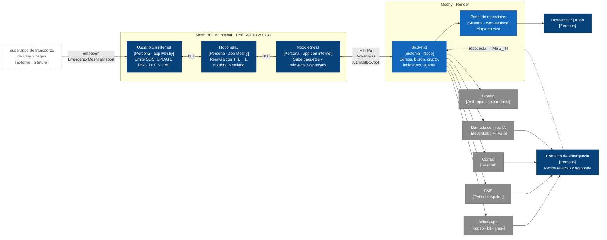

# 01 · C4 nivel 1: contexto

Quién usa Meshy y con qué sistemas externos habla. El mesh BLE lleva el paquete del
teléfono sin internet hasta un egress, y el backend, junto al agente IA, avisa a los contactos y responde por el mismo camino.

Estado: **propuesto**. Sincronizado con `6f254e6`: los proveedores son los que usa
`backend/src/channels.js` y `llm.js`. Fuentes: `CLAUDE.md`, `docs/contrato.md` §1, §4–§7,
`backend/README.md`.

## Elementos

| Elemento | Nombre real en el repo | Estado |
|----------|------------------------|--------|
| App en los tres papeles (origen, relay, egress) | `apps/android`, paquete `com.baliza.emergency` | Existen la interfaz (registro y SOS) y el módulo Baliza cableado en `EmergencyApp`: origen y relay funcionan. **El papel de egress no tiene código** |
| Mesh BLE | bitchat: `BluetoothMeshService`, `PacketProcessor`, `MessageType.EMERGENCY = 0x30` | Existe |
| Backend (con el agente dentro) | `backend/src/` (`api.js`, `routes/`, `egress.js`, `agent.js`, …) | **Existe** (132 pruebas) |
| Panel | `dashboard/` (Leaflet, SSE) | **Existe** |
| Proveedores | `backend/src/channels.js`, `llm.js` | Integrados; sin credenciales caen a `simulated` |

## Supuestos / decisiones abiertas

- **Notación.** Uso un `flowchart` con convenciones C4 (persona, sistema, externo, futuro con borde
  punteado) en vez de `C4Context`. El layout de `C4Context` en Mermaid es fijo y se amontona con 13
  elementos, así que no sirve para las láminas.
- **El mismo binario cumple los tres papeles.** Origen, relay y egress corren la misma app; lo que
  cambia es si hay internet. No es una topología forzada (D-2).
- **El agente vive dentro del backend.** No es un sistema aparte: es `agent.js`, con un plan fijo en
  código. Claude solo redacta el texto del aviso y no tiene herramientas (ver diagrama 5).
- **⚠ WhatsApp no está en el contrato.** El bit «sms» de `channels` sale por WhatsApp (Kapso) si hay
  credenciales, y si no por SMS (Twilio). El contrato (§3.3, §6) solo habla de SMS. Ver punto 15 en
  `README.md`.
- **Telegram fuera**, como dice `contrato.md` §6.
- **Rescatista.** En el demo el panel lo ven el equipo y el jurado. No hay contacto con servicios de
  emergencia reales (fuera de alcance).
- **Respuesta del contacto:** responde al WhatsApp, a un SMS o desde el enlace `/r/{token}` que trae el
  aviso (diagrama 4).
- **Superapps.** Es visión a futuro (Fase 5, primer corte del módulo). La GPL-3.0 de bitchat afecta a
  lo que la enlace.
