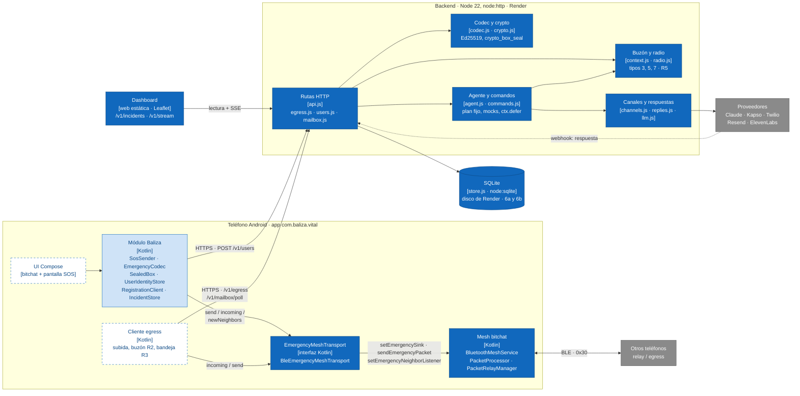

# 02 · C4 nivel 2: contenedores

Las piezas desplegables de Baliza Vital y cómo se hablan: la app Android en capas (UI, módulo Baliza,
`EmergencyMeshTransport`, mesh de bitchat), el backend en módulos, la base de datos y el dashboard.
Muestra qué existe ya en el código y qué está propuesto.

Estado: **propuesto**. Sincronizado con `431db2d`. Existen el backend (`backend/src/`), el panel
(`dashboard/`) y, en Android, el transporte, el módulo Baliza (`codec`, `crypto`, `identity`,
`registration`, `sos`) y los ganchos de bitchat. Faltan la UI SOS, el cliente egress y el cableado en la
app.

Leyenda: relleno azul = existe y se usa; azul claro = existe pero sin conectar a la app; borde
punteado = propuesto. Todos los módulos del backend usan `store.js`; para no cruzar flechas, solo se
dibuja una hacia la base.

## Capas de la app

| Capa | Paquete / clase | Responsabilidad | Estado |
|------|-----------------|-----------------|--------|
| UI | bitchat Compose + pantalla SOS | Categoría, severidad, texto, estados R4, CMD | Propuesto |
| Módulo Baliza | `com.baliza.emergency.{codec,crypto,identity,registration,sos}` | `EmergencyCodec` (§3, firma `BALIZA-V1`), `SealedBox` (compatible con libsodium), `UserIdentityStore` (llaves propias y del servidor, `SecurePrefs`), `RegistrationClient` (`POST /v1/users`), `SosSender` (R1, R4, ACK), `PrefsIncidentStore` (sobrevive a la muerte del proceso) | **Existe, sin conectar**. Faltan UPDATE/baliza R6, MSG_OUT, CMD, dictado y lectura en voz alta |
| Cliente egress | (sin código) | `POST /v1/egress`, `POST /v1/mailbox/poll` (R2), bandeja de salida (R3), presencia e inbox (R5) | Propuesto |
| Transporte | `EmergencyMeshTransport`, `BleEmergencyMeshTransport` | `send(payload, ttl): SendResult`, `incoming`, `newNeighbors` | **Existe** |
| Mesh | `BluetoothMeshService.setEmergencySink` / `sendEmergencyPacket` / `setEmergencyNeighborListener`, `PacketProcessor` (rama `EMERGENCY`), `PacketRelayManager` | Sobre v1, BROADCAST, firma del sobre, relevo con TTL − 1, aviso de vecino nuevo | **Existe** |

## Módulos del backend

| Módulo | Archivo | Rutas o papel |
|--------|---------|---------------|
| Rutas | `api.js`, `http.js`, `server.js` | Ensamblado, CORS, tokens de panel y admin |
| Registro | `users.js` | `POST /v1/users`, `PUT /v1/users/{id}/contacts` |
| Egress | `egress.js` | `POST /v1/egress` (validación, idempotencia, ACK síncrono) |
| Buzón | `mailbox.js`, `context.js` | `POST /v1/mailbox/poll`; `queueAck`, `queueMsgIn`, `queueCmdResult` |
| Radio (R5) | `radio.js` | `POST /v1/egress/presence`, `GET /v1/egress/inbox`, repetición cada 60 s |
| Agente | `agent.js`, `llm.js`, `prompts/alert-writer.txt` | `registrar_incidente`, `avisar_contactos`, `consultar_alertas`, `runSosAgent` |
| Comandos | `commands.js` | CMD → CMD_RESULT con mocks y banderas |
| Respuestas | `replies.js`, `tokens.js`, `reply-page.html` | `/r/{token}`, `/v1/replies`, `/v1/webhooks/whatsapp`, `/v1/webhooks/sms` |
| Canales | `channels.js` | WhatsApp (Kapso), SMS (Twilio), correo (Resend), voz (ElevenLabs) o consola |
| Panel | `api.js` | `GET /v1/incidents`, `/v1/incidents/{sender}/{incident}`, `/v1/events`, `/v1/stream` (SSE) |
| Datos | `store.js` | Todo el SQL (diagramas 6a y 6b) |

## Supuestos / decisiones abiertas

- **Cableado pendiente en Android.** Nadie llama todavía a `BleEmergencyMeshTransport.over(mesh)` ni crea
  un `SosSender`: el módulo Baliza solo corre en pruebas. Es lo que falta para la Fase 2 en el teléfono.
- **No hay cliente egress.** Ningún código del teléfono llama a `/v1/egress` ni a `/v1/mailbox/poll`. El
  backend se prueba con `scripts/post-vector.mjs`.
- **El agente no es un worker aparte.** `ctx.defer` corre en el mismo proceso, después de responder al
  egress. Si el proceso se reinicia, el aviso en curso se pierde (el `SIGTERM` espera 10 s).
- **Una sola instancia.** El límite de tasa, la cola diferida y el bus del SSE viven en memoria, y el
  disco de Render no se comparte. Ver punto 14 en `README.md` (SQLite en lugar de Postgres).
- **Stack distinto de `reparto.md`.** Se propuso Node + TypeScript + Express + Postgres; el código usa
  JavaScript (ESM), `node:http` sin framework y SQLite. `reparto.md` permitía cambiarlo avisando: solo
  queda registrado.
