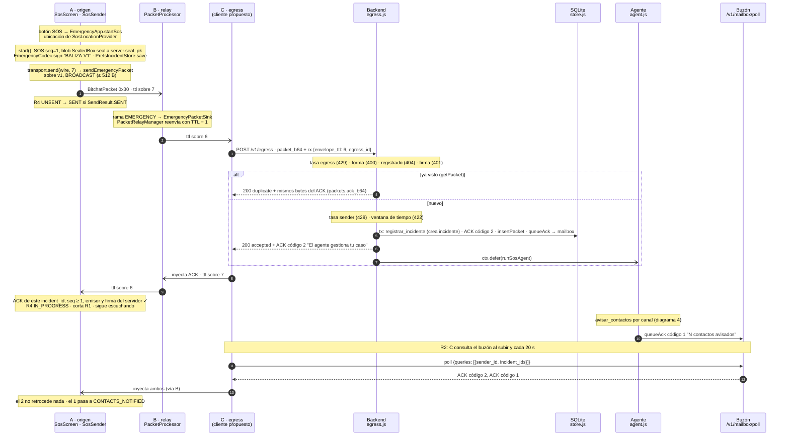

# 03 · Secuencia: SOS de A a backend y ACK de vuelta

Recorrido completo de un SOS: A (sin internet), luego B (relay), luego C (egress), backend y agente;
después, el ACK firmado por el servidor vuelve por el mesh hasta A. Incluye los reintentos (R1) y la
recogida del ACK de avance por el buzón (R2).

Estado: **propuesto**, sincronizado con `6f254e6`. Existen y tienen pruebas: en A, el botón SOS
(`SosScreen`) y `SosSender`, cableado en `EmergencyApp`; el relevo en B y todo el backend. **No existe el cliente egress de C**: subir a
`/v1/egress`, reinyectar y consultar el buzón siguen propuestos. Fuentes: `SosSender.kt`,
`egress.js`, `agent.js`, `context.js`; `contrato.md` §3, §4, §5.1 y §7.

## Lo que no se ve en el diagrama

- **R1, reintentos** (`SosSender.retryLoop`). Si A no recibe el ACK, reenvía los **mismos bytes**
  (mismo `seq`, misma firma) dentro de un sobre nuevo: cada 15 s durante 2 min, luego cada 60 s; a los
  30 min pasa a `STOPPED`. Un vecino nuevo (`newNeighbors`) reinicia la ventana tras esperar 1 s. A los
  30 s sin ACK, `SENT` pasa a `UNCONFIRMED`.
- **Muerte del proceso.** `PrefsIncidentStore` guarda el paquete y el último estado de ACK; `resume()`
  retoma los reintentos o solo escucha si ya había ACK.
- **Inundación.** bitchat no tiene rutas: B también reenvía hacia A y C hacia sus vecinos. El diagrama
  muestra solo el camino útil.
- **TTL.** El que decide el relevo es el del sobre (`BitchatPacket.ttl`). El `ttl` interno no se firma; el
  backend calcula `hops = ttl interno − envelope_ttl`.
- **R5.** Cada fila nueva del buzón también se encola para los egress cercanos (`pushToRadio`), que la
  recogen con `GET /v1/egress/inbox`. Es la alternativa al poll del paso final (diagrama 4).

## Supuestos / decisiones abiertas

- **⚠ El código reemplaza la decisión 1 (ACK de avance).** Se había aceptado "ACK síncrono con código 0;
  el avance (2 y 1) va por el buzón; el teléfono deduplica por `(incident_id, seq, category)`". Lo
  implementado es:
  - El ACK síncrono de un SOS o UPDATE lleva **código 2**; el de MSG_OUT y CMD, código 0 (código 3 si el
    blob no abre); el de un UPDATE que cierra (severity 0), código 0.
  - El código 1 llega después por el buzón, como otra fila del mismo `seq`.
  - `duplicate` devuelve los **bytes del primer ACK** (código 2), no "el más reciente".
  - El teléfono no deduplica: ordena por rango (`recibido < en_gestion < contactos_avisados`; `rechazado`
    es final) y nunca retrocede. Esto ya está en `contrato.md` §5.1 (R4).
  
  Propuesta: adoptar el código y dar de baja la decisión 1. Queda pendiente el ejemplo de §8, que trae
  código 1 en el ACK síncrono (punto 1 en `README.md`).
- **Quién crea el incidente: resuelto.** `/v1/egress` llama a `registrarIncidente` dentro de la misma
  transacción; el agente diferido ya lo encuentra creado.
- **El agente corre después de responder** (`ctx.defer`), en el mismo proceso. El ACK no espera al LLM.
- **El ACK de UPDATE no va al buzón:** la siguiente baliza ocupa su lugar (R6). Hoy el teléfono no envía
  UPDATE.
- **R1 del egress (bandeja R3)** y su manejo de 4xx y 429 siguen sin código.
