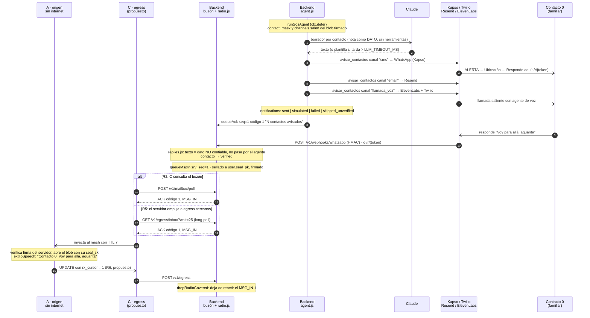

# 04 · Secuencia: aviso a contactos, llamada con voz IA y respuesta por el buzón

Qué pasa después del SOS (diagrama 3): el agente avisa a los contactos por WhatsApp o SMS, correo y
llamada con voz IA. El teléfono recibe el ACK de avance, y la respuesta de un familiar vuelve sellada al
teléfono sin internet a través del buzón y el mesh, donde se lee en voz alta.

Estado: **propuesto**, sincronizado con `6f254e6`. El lado del backend existe (`agent.js`,
`channels.js`, `replies.js`, `radio.js`). En el teléfono faltan el cliente egress (C), la apertura del
MSG_IN, la lectura en voz alta y la baliza UPDATE (R6). Fuentes: `backend/README.md`; `contrato.md`
§3.3, §5, §5.1 (R2, R5, R6), §6 y §7.

## Respuesta del teléfono (MSG_OUT)

El camino inverso usa las mismas piezas. A dicta con el reconocimiento de voz offline
(`SpeechRecognizer`), arma un `MSG_OUT` (tipo 4, `contact_idx` y `channels`, sellado al servidor) que
viaja como el SOS del diagrama 3. El backend responde ACK código 0 y, diferido, llama a
`avisar_contactos` con el texto del usuario (sin LLM). En el teléfono, MSG_OUT no tiene código todavía.

## Supuestos / decisiones abiertas

- **Respuesta del contacto: resuelto en código.** Entra por cuatro caminos, todos hacia `ingestReply`:
  - el webhook de Kapso, que se asocia al último incidente avisado a ese número;
  - la página `/r/{token}` del enlace del aviso, o `POST /v1/replies`;
  - el webhook de SMS de Twilio;
  - `/v1/dev/simulate-reply` para el demo.
- **⚠ WhatsApp en el bit «sms».** Con `KAPSO_API_KEY`, el canal `sms` del contrato sale por WhatsApp.
  Fuera de la ventana de 24 h exige plantillas aprobadas por Meta. El contrato no lo menciona (punto 15
  en `README.md`).
- **Contactos verificados.** Con canales reales solo se avisa a contactos `verified`. Si no, el aviso
  queda `skipped_unverified` y, si nadie fue alcanzado, no sale el ACK código 1.
- **ACK código 1 "[SIMULADO]".** Si todos los avisos fueron simulados (sin credenciales), el texto del ACK
  lo dice.
- **Límite de tamaño de MSG_IN.** El backend corta la respuesta a 240 caracteres y el texto sellado a
  259 B.
- **El teléfono no confirma cada MSG_IN** (R4): el recibo es el `rx_cursor` de la siguiente baliza. Mientras
  no lo cubra, `radioTick` lo reencola cada 60 s. El buzón lo conserva 24 h.
- **Voz IA.** `POST /v1/convai/twilio/outbound-call` de ElevenLabs. **No se probó contra la API real**
  (`backend/README.md`).
- **No hay reintentos de avisos fallidos.**
