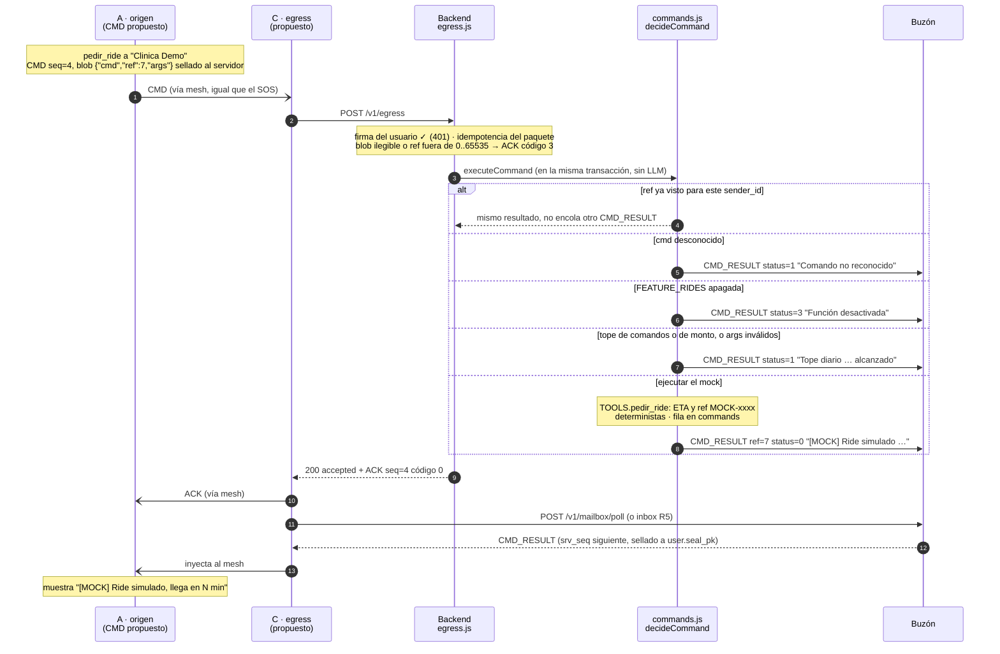

# 05 · Secuencia: comando al agente (recarga, pago, ride) con mocks y CMD_RESULT

Un `CMD` firmado por el usuario viaja por el mesh como cualquier paquete. El backend comprueba la
bandera de la función, la idempotencia y los topes diarios, ejecuta un **mock** y deja un `CMD_RESULT`
sellado al usuario en el buzón. Nada toca bancos ni plataformas reales.

Estado: **propuesto**, sincronizado con `6f254e6`. El backend existe (`egress.js` → `processCmd`,
`commands.js`); en el teléfono no hay código de CMD ni cliente egress. Fases 4 y 5, detrás de
`FEATURE_PAYMENTS` y `FEATURE_RIDES` (apagadas por defecto). Fuentes: `contrato.md` §3.3, §7 y §8.



## Comandos y banderas

| `cmd` | Bandera | Cuenta para el tope | Resultado |
|-------|---------|---------------------|-----------|
| `consultar_alertas` | ninguna | no (pero suma si sale bien) | Hasta 3 incidentes abiertos cercanos, de la base real |
| `preguntar_ia` | `FEATURE_ASK_AI` | no (tope propio: 20 por 24 h) | Respuesta real de la IA (≤ 250 B), **asíncrona**: ver abajo |
| `recargar_saldo` | `FEATURE_PAYMENTS` | sí, y monto | `[MOCK] Recarga simulada …` |
| `pagar` | `FEATURE_PAYMENTS` | sí, y monto | `[MOCK] Pago simulado …` |
| `pedir_ride` | `FEATURE_RIDES` | sí | `[MOCK] Ride simulado …, llega en 4–11 min` |
| `pedir_delivery` | `FEATURE_RIDES` | sí | `[MOCK] Delivery simulado …` |

`status` de CMD_RESULT: `0` ok, `1` rechazado, `2` error (excepción), `3` función desactivada. Topes
por usuario en 24 h: `CMD_MAX_PER_DAY = 10` comandos con `status = 0` y `CMD_MAX_AMOUNT_PER_DAY = 500`.

## Supuestos / decisiones abiertas

- **El CMD no pasa por el LLM: resuelto en código.** `commands.js` despacha por nombre y valida cada
  argumento con un esquema estricto. No hay modelo en el camino; el LLM solo redacta avisos (`llm.js`).
- **Solo un `CMD` firmado dispara herramientas monetarias o de movilidad** (§7). La nota del SOS, un
  MSG_IN o el texto de un contacto nunca lo hacen. Lo prueban los tests «INYECCIÓN» de `flow.test.js`.
- **Dos idempotencias distintas.** La del paquete `(sender_id, incident_id, seq, msg_type)` absorbe
  reintentos del mesh. La de negocio `(sender_id, ref)`, en la tabla `commands`, evita ejecutar dos veces
  la misma orden si llega con otro `seq`.
- **Un `ref` repetido no reencola el CMD_RESULT.** El original sigue en el buzón durante 24 h, así que el
  teléfono lo recibe por R2 o R5. Pasadas las 24 h no hay forma de recuperarlo.
- **Sin ACK código 2.** El CMD se resuelve dentro de la petición: el ACK síncrono es código 0 y el
  `CMD_RESULT` ya está en el buzón cuando el egress recibe la respuesta.
- **CMD fuera de un incidente.** El paquete exige `incident_id`. Para el demo, el CMD va dentro del
  incidente activo (como el ejemplo de §8); `consultar_alertas` usa su ubicación si no trae `lat` y `lon`.

## `preguntar_ia`: la excepción asíncrona

A diferencia de los mocks, la consulta a la IA **no** se resuelve dentro de la petición del egress:

```mermaid
sequenceDiagram
  autonumber
  participant A as A · origen
  participant C as C · egress
  participant API as Backend<br/>egress.js → ai.js
  participant LLM as Claude Haiku 5.5
  participant MB as Buzón

  A-)C: CMD {"cmd":"preguntar_ia","ref":9,"args":{"q":"…"}} (sellado)
  C->>API: POST /v1/egress
  alt bandera apagada · pregunta vacía o larga · tope · saturado
    API->>MB: CMD_RESULT status 1 o 3 (al momento)
    API-->>C: ACK código 0
  else aceptada
    API-->>C: ACK código 2 «Recibido. Consultando a la IA»
    API->>LLM: pregunta delimitada + categoría y gravedad (sin herramientas)
    LLM-->>API: texto (≤ 15 s; si no, status 2)
    API->>MB: CMD_RESULT ref=9 status 0, ≤ 250 B, sellado al usuario
  end
  C->>MB: POST /v1/mailbox/poll (o inbox R5)
  MB-->>C: CMD_RESULT
  C-)A: inyecta al mesh
```

Detalle y límites: `contrato.md` §7.1. El servidor solo guarda metadatos de la consulta (`ask_jobs`), nunca el texto.

