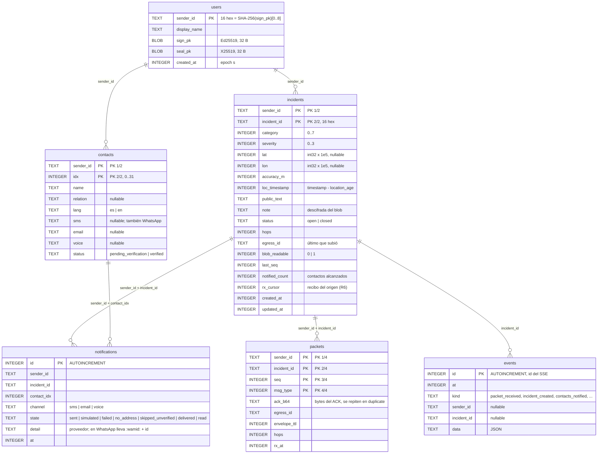

# 06a · ER del backend: identidad, incidentes y avisos

Primera mitad del modelo de datos real del backend (SQLite, `backend/src/store.js`): usuarios y
contactos, incidentes, paquetes recibidos (la tabla de idempotencia), avisos a contactos y eventos.
La segunda mitad (buzón, radio, comandos, ventana de WhatsApp) está en [06b](06b-er-entrega-agente.md).

Estado: **propuesto (calcado del código)**, sincronizado con `6f254e6`. Fuente: el `SCHEMA` de
`store.js`; contrato §3, §4, §6 y §7.

Las relaciones son **lógicas**: el esquema no declara `FOREIGN KEY`. Se unen por las columnas que
indica cada línea.

## Claves e índices

| Tabla | Clave / índice | Para qué |
|-------|----------------|----------|
| `users` | PK `sender_id` | Búsqueda por el `sender_id` del paquete (404 si no existe) |
| `contacts` | PK `(sender_id, idx)` | `contact_mask` e índices 0..31; `replaceContacts` borra y reinserta todo |
| `incidents` | PK `(sender_id, incident_id)` | Un incidente por par; `listIncidents` ordena por `updated_at` sin índice |
| `packets` | PK `(sender_id, incident_id, seq, msg_type)` | **Idempotencia** (§3.4): si existe, `duplicate` con `ack_b64` tal cual |
| `notifications` | solo PK `id` | Historial de avisos; `findNotifiedIncidentByPhone` une con `contacts` |
| `events` | solo PK `id` | Línea de tiempo del panel y cursor del SSE (`Last-Event-ID`) |

## Supuestos / decisiones abiertas

- **⚠ SQLite en lugar de Postgres + PostGIS** (punto 14 en `README.md`). El encargo pedía tipos de
  PostgreSQL, índices y PostGIS, y `reparto.md` proponía Postgres. El código usa `node:sqlite` en el disco
  de Render: no hay `geography`, las coordenadas son `INTEGER × 1e5` y las distancias se calculan en JS
  (haversine en `agent.js` y `radio.js`). `store.js` es el único punto de acceso, así que pasar a Postgres
  es reimplementar esa clase. Propuesta: SQLite para el demo; Postgres solo si hace falta más de una
  réplica.
- **Ids en hex.** `sender_id` e `incident_id` se guardan como `TEXT` de 16 caracteres hex, no como 8 B.
- **No hay tabla de tracking.** Cada UPDATE pisa la ubicación de `incidents`; la trayectoria solo queda en
  `events` (si el evento la trae). El panel muestra la última posición.
- **No se guarda el paquete crudo**, solo su ACK. Los paquetes rechazados (400, 401, 404, 422, 429) no
  dejan fila.
- **`note` en claro.** El backend descifra el `sealed_blob`, así que la nota queda en claro en la base. La
  retención de incidentes sigue sin definir (el buzón purga a las 24 h).
- **Contactos verificados.** Con canales reales solo se avisa a `verified` (o con
  `ALLOW_UNVERIFIED_CONTACTS=true`). Un contacto pasa a `verified` al responder o por
  `POST /v1/admin/contacts/verify`, y vuelve a `pending_verification` si cambia algún canal.
- **Llaves del servidor fuera de la base:** `server-keys.json` en el disco o `BALIZA_SIGN_SEED_HEX` y
  `BALIZA_SEAL_SK_HEX` en el entorno.
