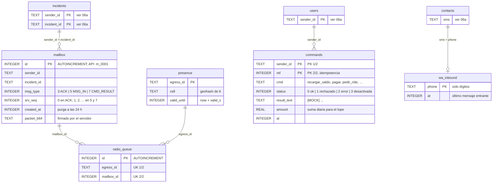

# 06b · ER del backend: buzón, radio y comandos

Segunda mitad del modelo de datos real (SQLite, `backend/src/store.js`): el buzón de salida (ACK,
MSG_IN, CMD_RESULT), la presencia de egress y la cola de envío por radio (R5), los comandos simulados y
la ventana de 24 h de WhatsApp. `users`, `incidents` y `contacts` vienen de [06a](06a-er-identidad-incidentes.md);
aquí solo se muestra su clave.

Estado: **propuesto (calcado del código)**, sincronizado con `6f254e6`. Fuentes: `store.js`,
`context.js`, `radio.js`, `commands.js`; contrato §5, §5.1 (R2, R5) y §7.

Como en 06a, el esquema no declara `FOREIGN KEY`: las relaciones son lógicas.

## Claves e índices

| Tabla | Clave / índice | Para qué |
|-------|----------------|----------|
| `mailbox` | `mailbox_lookup (sender_id, incident_id, id)` | `mailbox/poll` por pares y cursor (`next_cursor` = último `id`) |
| `mailbox` | (sin UNIQUE) | Un mismo `seq` puede tener varios ACK (código 2 síncrono y código 1 del agente) |
| `presence` | PK `egress_id` | Una celda vigente por egress; `listPresence` filtra por `valid_until` |
| `radio_queue` | UNIQUE `(egress_id, mailbox_id)` | `INSERT OR IGNORE`: reencolar cada 60 s no duplica |
| `commands` | PK `(sender_id, ref)` | Idempotencia por `(sender_id, ref)` (§7): un `ref` repetido no se re-ejecuta |
| `wa_inbound` | PK `phone` | Si el contacto escribió hace < 24 h, WhatsApp admite texto libre |

## Supuestos / decisiones abiertas

- **El ACK síncrono también va al buzón** (`queueAck`), salvo el de UPDATE: la siguiente baliza ocupa su
  lugar. El ACK de avance (código 1) lo deja `runSosAgent` como otra fila del mismo `seq`.
- **`srv_seq`** sale de `MAX(srv_seq) + 1` sobre los tipos 5 y 7 del incidente (`nextServerSeq`), no de un
  contador en `incidents`.
- **Qué se repite por radio.** Los ACK se empujan una vez; los tipos 5 y 7 se reencolan cada 60 s
  (`radioTick`) hasta que el `rx_cursor` del origen los cubre (`dropRadioCovered`). `GET /v1/egress/inbox`
  borra de `radio_queue` lo que entrega.
- **No hay tablas de acciones del agente ni de respuestas.** Una respuesta de contacto se guarda solo como
  MSG_IN sellado en `mailbox` y como evento `contact_reply`. El texto no se guarda en claro.
- **`commands` siempre es simulado.** Con la bandera apagada igual se guarda la fila con `status = 3`.
- **Monto en `REAL`** (coma flotante). Para un mock alcanza; con dinero real habría que usar unidades
  menores enteras.
