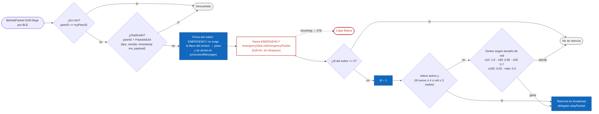

# 07a · Flujo: qué hace un nodo con un paquete EMERGENCY (capa bitchat)

La decisión de un nodo al recibir un paquete se toma en dos capas. Esta es la capa de **bitchat**:
deduplicación, firma del sobre, entrega al sumidero y relevo con TTL. Ocurre igual en todos los
nodos (origen, relay o egress). La capa de Baliza, que decide si subir o entregar localmente, está en
[07b](07b-flujo-nodo-baliza.md).

Estado: **propuesto (calcado del código)**; pasa a validado cuando lo revises. Revisado contra `431db2d`
(sin cambios en este flujo; solo se agregó el aviso de vecino nuevo en `onDeviceConnected`). Está
dibujado sobre `PacketProcessor.handleReceivedPacket`, `SecurityManager.validatePacket` y
`PacketRelayManager.handlePacketRelay` / `shouldRelayPacket`.

## Qué significa para Baliza

- **El relevo no depende del papel del nodo.** Un egress también retransmite, y un fallo del
  sumidero (`runCatching`) no detiene el relevo (probado en `EmergencyPacketTest`).
- **Con TTL 7** el paquete se reenvía siempre en los tres primeros saltos (TTL nuevo 6, 5 y 4). Desde
  el cuarto depende del tamaño de la red. En el demo, con 3 o 4 teléfonos (red ≤ 3 o ≤ 10), siempre se
  reenvía.
- **La deduplicación es del sobre**, no del paquete interno. Un reintento R1 usa un sobre nuevo (otro
  `timestamp`), así que bitchat lo deja pasar y lo reenvía. La deduplicación del paquete interno la
  hace la capa Baliza (07b).
- **El `ttl` que cuenta es el del sobre.** El `ttl` interno no se mira aquí.

## Supuestos / decisiones abiertas

- **Sin lista blanca del modo demo.** El encargo la pedía, pero contradice D-2 (sin topología
  forzada). Se quitó con tu aprobación del 2026-10-24.
- **Inyección de tráfico falso.** Como el sobre de un `EMERGENCY` no se autentica, cualquier nodo
  puede inyectar paquetes que se reenvían hasta agotar el TTL. El backend los rechaza (401) y el
  contrato (§9) deja pendiente un límite de tasa por emisor en el mesh.
- **Ruta de origen (v2)** no aplica: `EMERGENCY` va en v1 con `recipientID = BROADCAST`, así que la
  rama `route` de `PacketRelayManager` nunca se usa y "¿dirigido a mí?" siempre da no (se omite).
- **`isRelayEnabled`** es un interruptor de depuración de bitchat (`DebugSettingsManager`); en el demo
  tiene que estar activo.
