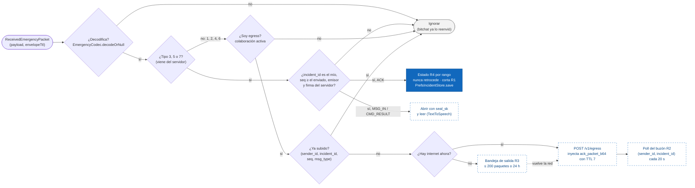

# 07b · Flujo: qué hace un nodo con un paquete EMERGENCY (capa Baliza)

La segunda capa de la decisión: lo que hace la app con cada `ReceivedEmergencyPacket` que entrega
`EmergencyMeshTransport.incoming`. Decide si entrega el paquete localmente (es para mí), lo sube (soy
egress) o no hace nada. El reenvío ya lo hizo bitchat en paralelo ([07a](07a-flujo-nodo-bitchat.md)).

Estado: **propuesto**, sincronizado con `431db2d`. La rama de entrega local de un **ACK** existe en
`SosSender.onReceived` (en azul). La entrega de MSG_IN y CMD_RESULT y toda la rama de egress no
existen. Fuentes: `SosSender.kt`; `contrato.md` §3.2, §3.4, §4 y §5.1 (R2, R3, R4).

Leyenda: azul = existe (`SosSender`); borde punteado = propuesto; las decisiones de la rama de egress
también son propuestas.

## Supuestos / decisiones abiertas

- **El teléfono origen no deduplica ACK.** `SosSender` acepta cualquier ACK válido y decide por rango
  (`RECEIVED < IN_PROGRESS < CONTACTS_NOTIFIED`; `REJECTED` es final). Un ACK repetido no cambia nada.
  Esto reemplaza el "dedup por `(incident_id, seq, category)`" de la decisión 1 (ver diagrama 3).
- **El egress sí debería deduplicar antes de subir.** bitchat deja pasar los reintentos R1 (sobre nuevo)
  y el backend responde `duplicate` sin cobrar tasa, así que subir de más no rompe nada, pero gasta
  datos. Propuesta: cache en memoria con vencimiento.
- **El egress no verifica la firma del usuario.** El paquete trae `sender_id` (hash de la llave), no la
  llave pública, así que el egress no puede verificar: sube todo lo que decodifica y el backend filtra
  (401 o 404). Un atacante puede gastar la cuota de un egress; lo frena el 429 del backend.
- **Un duplicado igual cuenta como "oído" para R2.** Si un egress vuelve a oír un `incident_id`, sigue
  consultando el buzón. En el diagrama, la rama "ya subido" termina en "ignorar" para no cruzar
  flechas; la implementación debe refrescar la marca de "oído".
- **Hoy solo hay un incidente a la vez** (`StartResult.AlreadyActive`), y `SosSender` solo escucha ACK.
- **Sin TTL en esta capa.** El `ttl` interno solo mide saltos y no está firmado (§3.2).
- **Sin lista blanca del modo demo** (D-2, quitada con tu aprobación).
