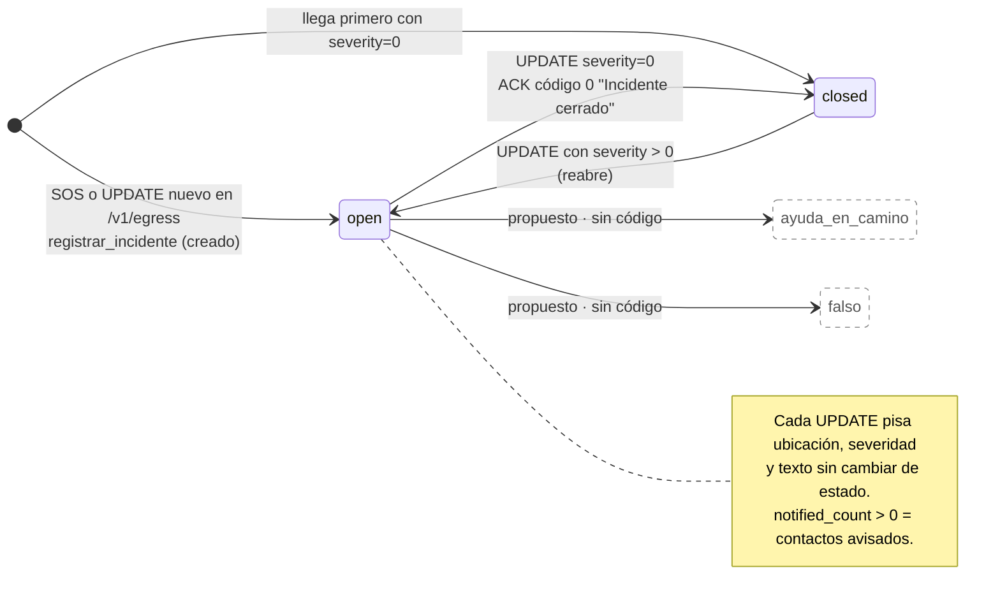

# 08a · Estados del incidente en el backend

Ciclo de vida de un incidente en el backend (`incidents.status`, ver 06a) y qué paquete produce cada
transición. Con borde punteado, los estados que se habían propuesto y el código no tiene. Los estados
que ve el teléfono están en [08b](08b-estados-sos-telefono.md).

Estado: **propuesto (calcado del código)**, sincronizado con `6f254e6`. Fuentes:
`agent.js` → `registrarIncidente`, `egress.js` → `processSos`; `contrato.md` §3.3 y §5.1 (R6).

## Qué guarda el backend en cada momento

| Momento | `status` | Otras columnas | ACK que sale |
|---------|----------|----------------|--------------|
| SOS aceptado | `open` | crea la fila, `blob_readable`, `hops` | código 2 síncrono |
| Agente terminó de avisar | `open` | `notified_count = N` | código 1 por el buzón, si N > 0 |
| UPDATE (baliza) | `open` | ubicación, `rx_cursor`, `last_seq` | código 2 síncrono, no va al buzón |
| UPDATE con `severity = 0` | `closed` | — | código 0 "Incidente cerrado" |
| Paquete del mismo `seq` repetido | sin cambio | — | los mismos bytes del primer ACK |

## Supuestos / decisiones abiertas

- **`severity = 0` → `closed`: resuelto en código.** No hay distinción entre `resuelto` y `falso`.
- **⚠ `ayuda_en_camino` sigue abierto (punto 7).** El código no tiene ese estado y el panel es de solo
  lectura: no hay `PATCH` ni ruta para marcarlo. Tampoco hay código de ACK para avisarle al teléfono.
  Propuesta, sin cambios: lo marca una persona en el panel (ruta de admin con `ADMIN_TOKEN`) y se agrega
  el ACK código 4 "ayuda en camino" al contrato.
- **`falso`** tampoco existe. Propuesta: marcarlo desde el panel con la misma ruta de admin; si no hace
  falta para el demo, se descarta.
- **El texto de un contacto no cambia el estado.** "Voy para allá" es dato no confiable (§7) y no pasa
  por el agente.
- **Cierre automático.** No hay. Un incidente queda `open` hasta que llega un UPDATE con `severity = 0`.
- **UPDATE sin SOS previo.** Si llega antes que el SOS, crea el incidente igual y el agente corre una
  sola vez (`ctx.agentStarted` y `notifications` vacías).
