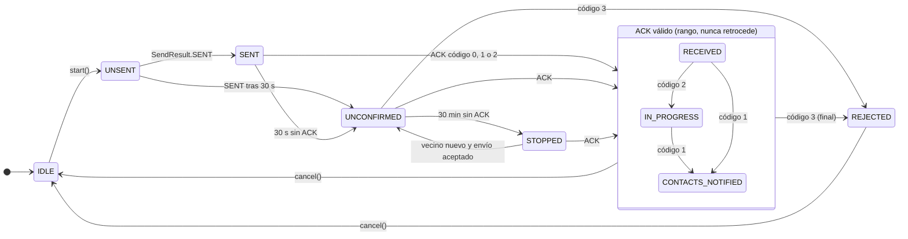

# 08b · Estados del SOS en el teléfono (R4)

Lo que la app puede decirle al usuario sobre su SOS (`SosState`) y qué evento produce cada
transición. La UI nunca muestra "recibido" ni "avisados" sin un ACK firmado por el servidor.

Estado: **propuesto (calcado del código)**, sincronizado con `431db2d`. Fuentes: `SosModels.kt`
(`SosState`, `RetrySchedule`), `SosSender.kt`; `contrato.md` §5.1 (R1 y R4).

## Correspondencia con el contrato

| `SosState` | R4 (`contrato.md`) | Qué pasa con los reintentos |
|------------|--------------------|-----------------------------|
| `UNSENT` | `sin_enviar` | Sigue reintentando |
| `SENT` | `enviado` | Sigue (cada 15 s, luego 60 s) |
| `UNCONFIRMED` | `sin_confirmar` | Sigue |
| `STOPPED` | `detenido` | Espera un vecino nuevo (`newNeighbors`) y abre otra ventana de 30 min |
| `RECEIVED`, `IN_PROGRESS`, `CONTACTS_NOTIFIED` | `recibido`, `en_gestion`, `contactos_avisados` | Se cortan; sigue escuchando ACK |
| `REJECTED` | `rechazado` | Se cortan; es final |

## Supuestos / decisiones abiertas

- **Con el código actual del backend, el primer ACK es código 2**, así que el teléfono pasa de
  `SENT` a `IN_PROGRESS` directo y `RECEIVED` solo aparece en MSG_OUT o CMD (que el teléfono todavía no
  envía). El diagrama muestra todas las transiciones que admite `SosSender`.
- **Desde cualquier estado previo al ACK** se puede llegar a un estado de ACK; el diagrama dibuja las
  flechas de `SENT`, `UNCONFIRMED` y `STOPPED` y omite las de `UNSENT` para no saturar.
- **Sobrevive a la muerte del proceso.** `PrefsIncidentStore` guarda el paquete y el último estado de
  ACK; `resume()` vuelve a `UNSENT` con una ventana nueva o al estado de ACK guardado.
- **`cancel()` no avisa al servidor.** Cerrar el incidente es un UPDATE con `severity = 0` (R6), que el
  teléfono todavía no envía.
- **Un incidente a la vez.** `start()` devuelve `AlreadyActive` si hay otro en curso, y `NotRegistered`
  si no hay llaves del servidor (falta `POST /v1/users`).
