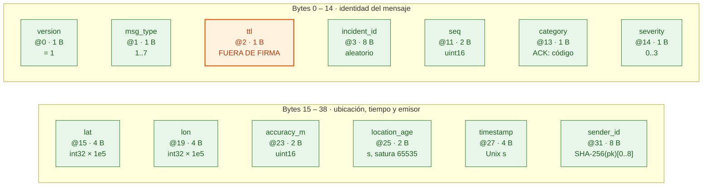

# 09a · Paquete binario: cabecera fija (39 B)

Los primeros 39 bytes del paquete interno de Baliza (`contrato.md` §3.1), campo por campo, con
offset y tamaño. Todo va en claro y todo va firmado **excepto `ttl`**, que queda fuera de la firma
para poder reescribirlo. Big-endian.
El cuerpo, la firma y el sellado están en [09b](09b-paquete-cuerpo-firma.md); el sobre de bitchat
que lo transporta, en [09c](09c-paquete-sobre-bitchat.md).

Estado: **propuesto (calcado del código)**, revisado contra `6f254e6`. Coincide con
`EmergencyCodec.encodeUnsigned` (Android) y `backend/src/codec.js`: 39 B de cabecera, `TTL_OFFSET = 2`,
`NO_LOCATION = Int.MIN_VALUE`. Fuente: `contrato.md` §3.1–§3.4 y los vectores de
`docs/examples/examples.json`.



Leyenda: verde = firmado y en claro; naranja = en claro y **sin** firma.

## Ejemplo: SOS de los vectores (§8)

```
01 01 07 0a68279fb49bde12 0001 01 03 00100464 ff99fd8c 000c 0004 6b2e5ac0 930bda7e20b63bb9
v  mt ttl incident_id     seq  ca sv lat      lon      acc  age  timestamp sender_id
```

`lat = 0x00100464 = 1049700` (10.49700°), `lon = 0xff99fd8c = −6685300` (−66.85300°).

## Supuestos / decisiones abiertas

- **Sin ubicación:** `lat = lon = −2147483648` (`0x80000000`), como en los ACK de ejemplo.
- **`category` cambia de sentido según el tipo:** en el ACK es el código (0 recibido, 1 contactos
  avisados, 2 en gestión, 3 rechazado). El teléfono los ordena por rango, no por valor
  (`SosSender`: recibido < en gestión < contactos avisados; rechazado es final). Ver diagrama 8b.
- **`timestamp` en segundos (uint32)** alcanza hasta 2106. El sobre de bitchat usa milisegundos; son
  relojes distintos.
- **`ttl` interno:** copia el valor inicial y sirve para contar saltos (`saltos = ttl − envelopeTtl`).
  No se usa para decisiones de seguridad.
