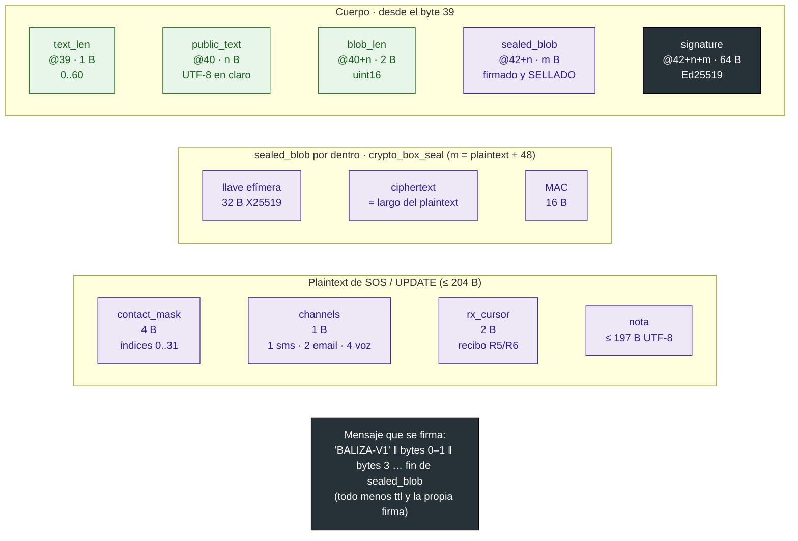

# 09b · Paquete binario: cuerpo, firma y sellado

Lo que sigue a la cabecera de 39 B ([09a](09a-paquete-cabecera.md)): texto público, `sealed_blob` y la
firma Ed25519. Muestra qué ven los nodos del mesh (en claro), qué solo abre el destinatario
(sellado) y qué cubre la firma. Abajo, el contenido del plaintext sellado de un SOS o un UPDATE.

Estado: **propuesto (calcado del código)**, revisado contra `431db2d`. Coincide con `EmergencyCodec`
(firma sobre `"BALIZA-V1"` ‖ bytes sin `ttl`), `SealedBox.kt` y `backend/src/crypto.js`; la
compatibilidad con libsodium está probada con `docs/examples/sealedbox-vectors.json`. Fuente:
`contrato.md` §2.1, §3.1, §3.3 y §3.5.

Leyenda: verde = en claro y firmado (lo ve cualquier nodo); violeta = sellado (solo lo abre el
destinatario) y firmado; gris oscuro = firma.

## Qué va sellado a quién

| Tipo | `public_text` | `sealed_blob` sellado a | Plaintext | Máx. total |
|------|---------------|-------------------------|-----------|-----------|
| 1 SOS, 2 UPDATE | ≤ 60 B | `server.seal_pk` | `contact_mask`·`channels`·`rx_cursor`·nota | 418 B |
| 3 ACK | ≤ 60 B | sin blob | — | 166 B |
| 4 MSG_OUT | 0 | `server.seal_pk` | `contact_idx`·`channels`·texto | 418 B |
| 5 MSG_IN | 0 | `user.seal_pk` | `contact_idx`·`channel`·texto | 418 B |
| 6 CMD | 0 | `server.seal_pk` | JSON `{"cmd","ref","args"}` | 418 B |
| 7 CMD_RESULT | 0 | `user.seal_pk` | `ref`(2)·`status`(1)·texto | 418 B |

Presupuesto: 39 de cabecera + 3 de longitudes + 64 de firma = **106 B fijos**, y quedan **312 B** para
`public_text + sealed_blob`.

## Supuestos / decisiones abiertas

- **Lo que ven los nodos intermedios:** cabecera completa (incluida la ubicación exacta),
  `public_text` y longitudes. La ubicación **no** va sellada; es una decisión del contrato (el
  egress y el mapa la necesitan), pero es un dato personal que viaja en claro por el mesh. Vale la pena
  decirlo en el pitch.
- **La firma cubre el blob ya sellado** (firma sobre el ciphertext), así que el backend verifica antes
  de descifrar.
- **Compatibilidad del sellado:** Android tiene que producir exactamente `crypto_box_seal` de
  libsodium (BouncyCastle o `lazysodium-android`, decisión de Dev A en `reparto.md`).
- **El ACK no lleva blob:** su texto público ("Recibido. 2 contactos avisados") lo ve todo el mesh.
