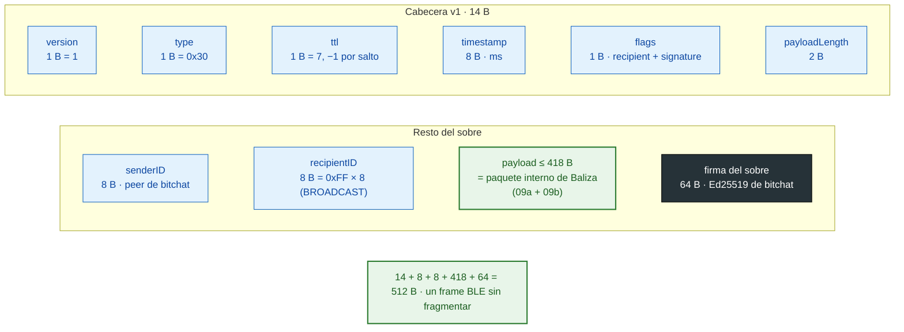

# 09c · Paquete binario: el sobre de bitchat

Cómo viaja el paquete interno por el mesh: como `payload` de un `BitchatPacket` v1 de tipo
`EMERGENCY = 0x30`, con `recipientID = BROADCAST` y firmado con la identidad de bitchat del emisor
del sobre. El total cabe en un solo frame BLE de 512 B, sin fragmentar.

Estado: **propuesto (calcado del código)**; pasa a validado cuando lo revises. Revisado contra `431db2d`
(sin cambios). Coincide con:
`BinaryProtocol` (`HEADER_SIZE_V1 = 14`, `Flags`), `BluetoothMeshService.sendEmergencyPacket` y la
prueba de 418 B en `EmergencyPacketTest`. Fuente: `contrato.md` §2 y §2.1.

Leyenda: azul = campos de bitchat (no se tocan); verde = lo nuestro; gris oscuro = firma.

## Dos firmas, dos TTL, dos relojes

| | Sobre de bitchat | Paquete interno de Baliza |
|-|------------------|---------------------------|
| Firma | Identidad de bitchat de **quien emite el sobre**. Para `EMERGENCY` nadie la exige (`verifyPacketSignature` devuelve `true`) | Ed25519 del usuario o del servidor; la verifica el backend o el teléfono |
| TTL | Decide el relevo; cada nodo resta 1 | Copia del inicial; solo cuenta saltos |
| Tiempo | `timestamp` en ms; con el payload forma el ID de duplicado (`PacketIdUtil`) | `timestamp` en s; ventana de 10 min / 7 días en el backend |
| Cambia en cada reintento | Sí: sobre nuevo, otro `timestamp` | No: mismo paquete, misma firma |

## Supuestos / decisiones abiertas

- **⚠ Compresión y el byte que sobra.** bitchat comprime si el payload mide ≥ 100 B y tiene < 90 % de
  bytes únicos (`CompressionUtil.shouldCompress`). Usa el resultado si es **apenas 1 B** más chico
  (`compress`), y añade un campo de 2 B. Un payload de 418 B que comprima a 417 B pasa a 419 B, y el
  sobre a 513 B: **se fragmenta**. El contrato (§2) dice "peor caso +1 B; se deja margen de 6 B",
  pero la cuenta de §2.1 da 512 exactos, sin margen. `EmergencyPacketTest` prueba lo aleatorio (no
  comprime) y el relleno (comprime mucho), pero no este borde. Sigue igual en `431db2d`. Ver el punto 13 en `README.md`.
- **El egress reinyecta un ACK con su propio sobre:** el `senderID` del sobre es el egress, no el
  servidor. Por eso el teléfono confía en la firma interna, nunca en el sobre.
- **Fragmentación:** permitida como contingencia, pero ningún tipo la necesita si se respeta el límite
  de 418 B.
