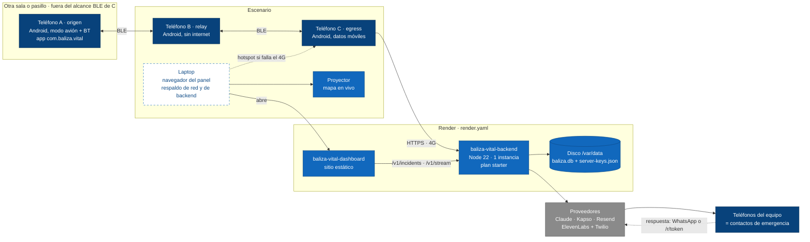

# 10 · Despliegue del demo

Dónde corre cada pieza el día del demo: tres teléfonos Android (A sin internet, B relay, C egress)
separados para forzar un salto, una laptop de respaldo, el backend y el panel en Render, y el panel
proyectado. Los avisos llegan a teléfonos del equipo (datos sintéticos).

Estado: **propuesto**, sincronizado con `431db2d`. El papel de la laptop está **por confirmar**.
Fuentes: `render.yaml`, `backend/README.md`, `dashboard/README.md`, `fases.md` y `reparto.md`.

## Checklist físico

| Pieza | Configuración |
|-------|---------------|
| A | Modo avión con Bluetooth encendido; ubicación activada (GPS sin red); registrado antes con internet (`POST /v1/users`) para tener las llaves del servidor |
| B | Sin SIM o sin datos, Bluetooth encendido, app abierta; en el medio, a la vista de A y de C |
| C | Datos móviles, "colaborar como egress" activo; lejos de A para que el salto pase por B |
| Laptop | Panel abierto con `?api=https://<backend>` y `DASHBOARD_TOKEN`; hotspot listo; copia local del backend lista para arrancar |
| Render | `BALIZA_SIGN_SEED_HEX` y `BALIZA_SEAL_SK_HEX` fijados. Si se regeneran las llaves, los teléfonos registrados dejan de entender al servidor |
| Render | `ADMIN_TOKEN` (para verificar contactos y simular respuestas) y `DASHBOARD_TOKEN` definidos |
| Contactos | Teléfonos del equipo registrados como contactos 0 y 1 y **verificados** (`POST /v1/admin/contacts/verify`), o `ALLOW_UNVERIFIED_CONTACTS=true`. Sin eso, con canales reales nadie recibe el aviso |
| WhatsApp | Cada contacto del equipo escribe antes al número de Kapso (abre la ventana de 24 h) o hay plantillas aprobadas. Webhook de Kapso apuntando a `/v1/webhooks/whatsapp` con `KAPSO_WEBHOOK_SECRET` |
| Banderas | `FEATURE_PAYMENTS` y `FEATURE_RIDES` encendidas solo en el entorno del demo, si se muestran las Fases 4 y 5 |

## Supuestos / decisiones abiertas

- **⚠ "Laptop como egress de respaldo": ¿qué significa?** (punto 12, sin cambios). Una laptop no corre
  bitchat, así que no puede oír el mesh BLE sin un desarrollo nuevo. Propongo que la laptop respalde en
  dos niveles, sin código extra:
  1. **Red:** comparte internet a C (hotspot) si falla el 4G del lugar.
  2. **Backend:** corre `npm start` en `backend/` y el panel con `python3 -m http.server`, y C apunta a
     ella si Render falla. Ojo: la copia local tiene **otras llaves** salvo que use las mismas
     `BALIZA_SIGN_SEED_HEX` y `BALIZA_SEAL_SK_HEX`, y otros usuarios registrados.

  Alternativa con código: un cuarto teléfono Android como egress de reserva. Si "egress" se refería a
  `scripts/post-vector.mjs`, eso **simula** un egress y en el pitch no se puede presentar como real.
- **Una sola instancia.** El disco persistente de Render y los límites en memoria lo exigen
  (`render.yaml`). Un redespliegue durante el demo corta el SSE del panel (se reconecta solo) y espera
  hasta 10 s a los avisos en curso.
- **Forzar el salto.** A y C no deben verse por BLE (otra sala o distancia). Sin eso, C oye a A directo
  y el salto por B no se demuestra. El panel muestra `hops` del incidente.
- **Plan B honesto** (`reparto.md`): si A–B–C falla en el lugar, se hace con A–C y se dice. Si fallan los
  canales reales, el ACK dice `[SIMULADO]` y el panel marca `simulado`: no se presenta como aviso real.
- **Llamada con voz IA** no probada contra la API real (`backend/README.md`). Conviene probarla antes o
  sacarla del guion.
- **Falta en el teléfono** lo que hace funcionar este despliegue: la UI SOS, el cableado de
  `SosSender` y el cliente egress de C (diagrama 2).
